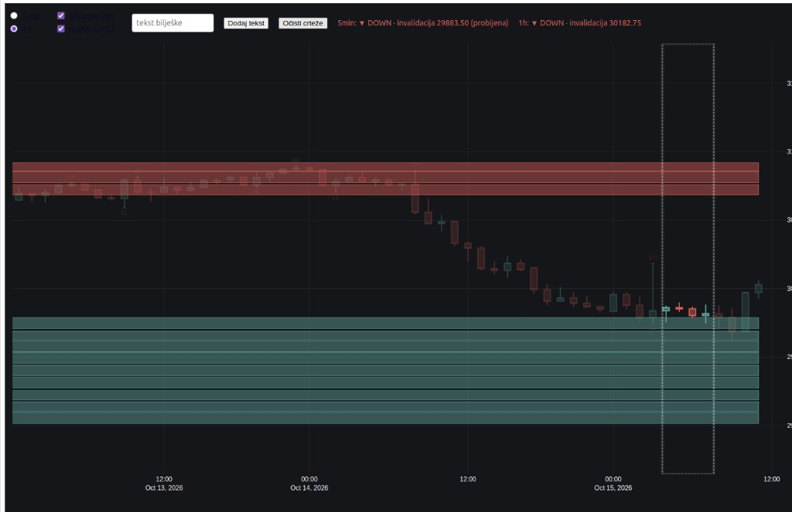

# better-futures

Interaktivni graf za **Micro Nasdaq futures (MNQ=F)** — candlestick chart s automatskom analizom i alatima za bilješke.



## Što radi

- **5 min / 1 h** candlestick graf (prebacivanje jednim klikom)
- **S/R zone** računate na 1h, prikazane i na 5m (crveno = otpor, zeleno = podrška)
- **HH / HL / LH / LL** swing oznake + trend (UP / DOWN / RANGE) s invalidacijom
- **Crtanje** preko grafa: linija, olovka, pravokutnik, krug, gumica
- **Tekst bilješke** — dodaj, povuci, klikni za uređivanje
- Podaci s **Yahoo Finance** (yfinance), lokalni cache u `mnq_5m.csv`

## Pokretanje

```bash
python3 -m venv .venv
.venv/bin/pip install -r requirements.txt
.venv/bin/python ui.py
```

Otvori http://127.0.0.1:8050
